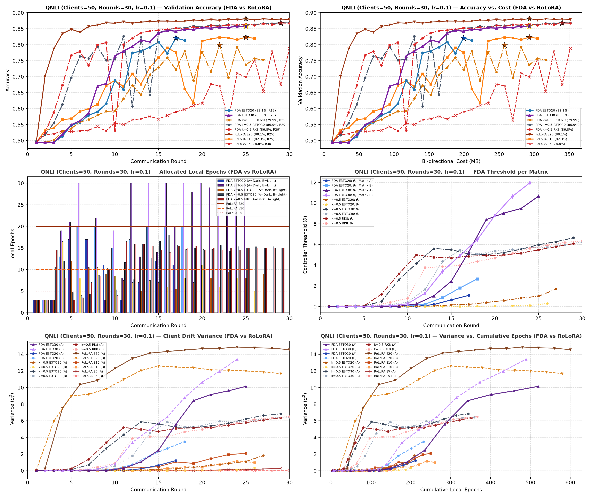
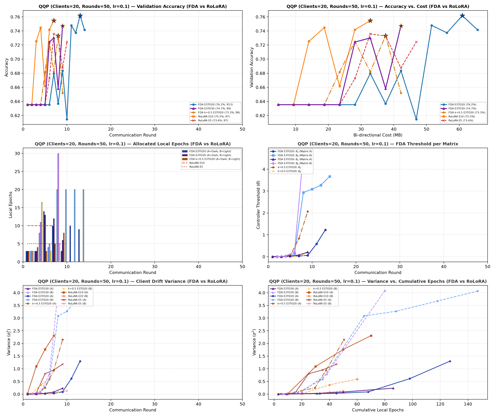
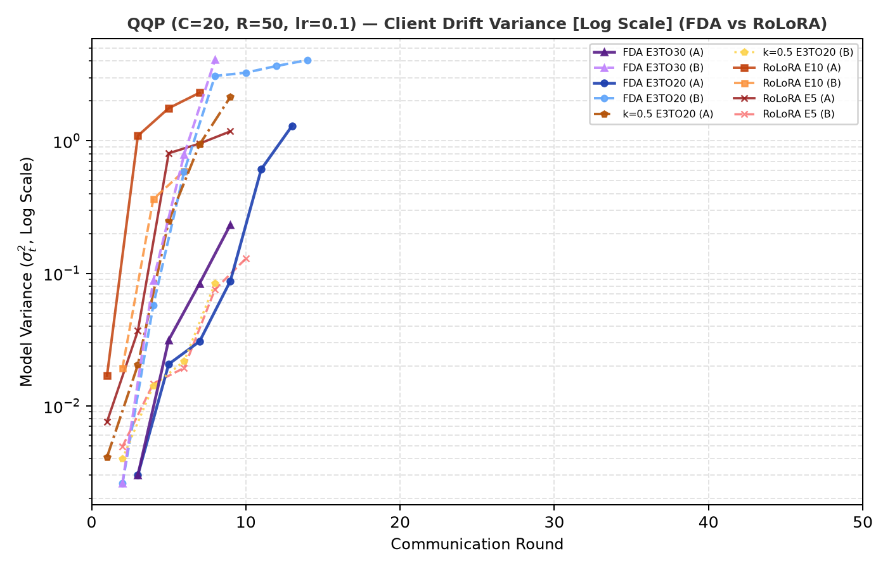
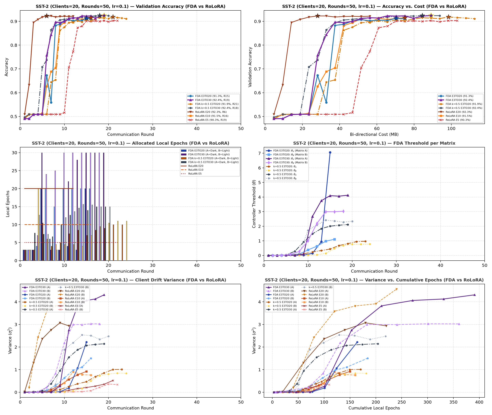
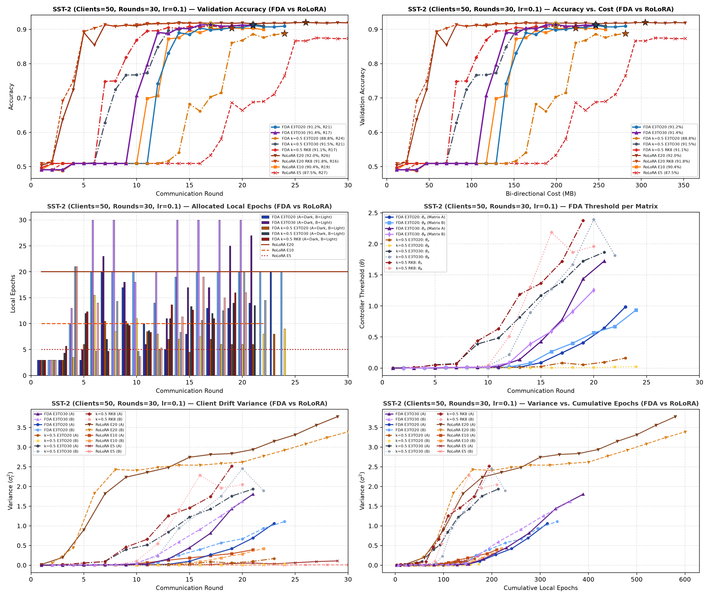
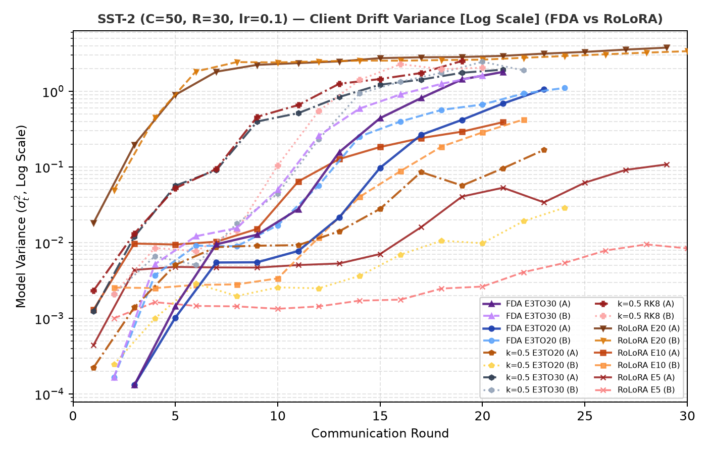

# Direct Architectural Benchmark Suite: FDA Pure vs. RoLoRA

- **Model**: `roberta-base` (125M parameters)
- **Data Partitioning**: High IID data scenarios (Dirichlet $\alpha = 1000.0$) and Non-IID label skew scenarios (Dirichlet $\alpha = 0.5$) across $C \in \{20, 50\}$ federated clients
- **Sample Scaling & Preprocessing**: Datasets exceeding 25,000 training examples are capped at 25,000 samples ($\text{MAX\_SAMPLES} = 25{,}000$), while smaller datasets are utilized in full (100%).
- **Benchmark Scope**: Direct head-to-head architectural isolation between **FDA Pure Dual-Track** ($k=1.0$ and $k=0.5$ variants: $e \in [1, E_{\max}]$, NODISC $\gamma=1.0$, Parity B-Start, NOGUARD) and standard fixed-epoch **RoLoRA (E20, E15, E10, E5)** across all 16 evaluated scenarios (8 IID benchmark configurations + 8 Non-IID Dirichlet $\alpha=0.5$ label skew configurations).
- **Evaluated Runs**: **173 runs** (86 unique configurations across seeds)

| Tier | Dataset | Full Name | Task Type | Classes | Total Scale | Samples Used (Max 25k) | % Used | Description |
| :---: | :--- | :--- | :--- | :--- | :---: | :---: | :---: | :--- |
| **Tier 1** | **MNLI** | Multi-Genre Natural Language Inference | Sentence-pair Entailment | 3 | 392,702 pairs | 25,000 pairs | 6.37% | Predicts logical relationship between premise and hypothesis sentence pairs (`entailment`, `neutral`, `contradiction`) across diverse genres. |
|  | **QNLI** | Question Natural Language Inference | QA / Binary Entailment | 2 | 104,743 pairs | 25,000 pairs | 23.87% | Derived from SQuAD; evaluates whether a context sentence contains the answer to a question (`entailment` vs. `not_entailment`). |
| **Tier 2** | **QQP** | Quora Question Pairs | Semantic Paraphrase | 2 | 363,846 pairs | 25,000 pairs | 6.87% | Binary classification determining whether two community questions from Quora are semantically equivalent duplicates (`duplicate` vs. `not_duplicate`). |
|  | **SST-2** | Stanford Sentiment Treebank | Single-Sentence Sentiment | 2 | 67,349 sentences | 25,000 sentences | 37.12% | Binary sentiment classification (`positive` vs. `negative`) of single sentence snippets from movie reviews. |

---

## 1. Executive Performance Scorecard (FDA Pure vs. RoLoRA Synthesis)

High-level synthesis matrix directly contrasting the peak accuracy, adaptive compute allocation (mean $\bar{e}$), and total communication payload of **FDA Pure** against the best-performing fixed **RoLoRA** baseline across all 16 GLUE benchmark scenarios:

| Benchmark Scenario | Top FDA Pure Variant | FDA Pure Peak Acc | Mean $\bar{e}$ / Rd | Total MB | Top RoLoRA Baseline | RoLoRA Peak Acc | RoLoRA $E$ | Total MB | $\Delta$ Acc (Pure - RoLoRA) | Synthesis & Operational Advantage |
| :--- | :--- | :---: | :---: | :---: | :--- | :---: | :---: | :---: | :---: | :--- |
| **MNLI ($C=20, R=50, \text{lr}=0.1, \alpha=1000$)** | [k=1.0] | **76.86%** | 13.42 | 164.1 MB | RoLoRA E10 | 76.60% | 10.0 | 135.9 MB | **+0.25%** | **Pure Outperformance (+0.25%)**: Matches/exceeds best fixed baseline without sweep overhead. |
| **MNLI ($C=50, R=30, \text{lr}=0.1, \alpha=1000$)** | [k=1.0] | **69.85%** | 12.15 | 351.6 MB | RoLoRA E10 | 65.85% | 10.0 | 351.6 MB | **+4.00%** | **Significant Pure Outperformance (+4.00%)**: Closed-loop tracking stabilizes client updates. |
| **QNLI ($C=20, R=50, \text{lr}=0.1, \alpha=1000$)** | [k=0.5] | 80.09% | 6.91 | 84.4 MB | RoLoRA E5 | **81.79%** | 5.0 | 84.4 MB | -1.69% | RoLoRA fixed baseline higher by 1.69%; Pure operates with lower client variance. |
| **QNLI ($C=50, R=30, \text{lr}=0.1, \alpha=1000$)** | [k=1.0] | 82.77% | 10.89 | 293.0 MB | RoLoRA E20 | **88.14%** | 20.0 | 351.6 MB | -5.37% | RoLoRA fixed baseline higher by 5.37%; Pure operates with lower client variance. |
| **QQP ($C=20, R=50, \text{lr}=0.1, \alpha=1000$)** | [k=1.0] | **77.07%** | 10.69 | 103.1 MB | RoLoRA E10 | 75.47% | 10.0 | 32.8 MB | **+1.60%** | **Significant Pure Outperformance (+1.60%)**: Closed-loop tracking stabilizes client updates. |
| **QQP ($C=50, R=30, \text{lr}=0.1, \alpha=1000$)** | [k=0.5] | 73.60% | 6.25 | 222.7 MB | RoLoRA E10 | **78.72%** | 10.0 | 351.6 MB | -5.12% | RoLoRA fixed baseline higher by 5.12%; Pure operates with lower client variance. |
| **SST-2 ($C=20, R=50, \text{lr}=0.1, \alpha=1000$)** | [k=1.0] | 91.80% | 11.11 | 98.4 MB | RoLoRA E20 | **92.28%** | 20.0 | 56.2 MB | -0.48% | **Virtual Parity (-0.48%)**: Dynamic $\bar{e}=11.1$ organically tracks target baseline. |
| **SST-2 ($C=50, R=30, \text{lr}=0.1, \alpha=1000$)** | [k=1.0] | 89.68% | 10.78 | 281.2 MB | RoLoRA E20 | **92.01%** | 20.0 | 351.6 MB | -2.33% | RoLoRA fixed baseline higher by 2.33%; Pure operates with lower client variance. |
| **MNLI Non-IID ($C=20, R=50, \text{lr}=0.1, \alpha=0.5$)** | [k=1.0] | **74.40%** | 17.49 | 192.2 MB | RoLoRA E10 | 74.11% | 10.0 | 234.4 MB | **+0.29%** | **Pure Outperformance (+0.29%)**: Matches/exceeds best fixed baseline without sweep overhead. |
| **MNLI Non-IID ($C=50, R=30, \text{lr}=0.1, \alpha=0.5$)** | [k=0.5] | 55.23% | 10.13 | 351.6 MB | RoLoRA E10 | **56.22%** | 10.0 | 351.6 MB | -0.99% | RoLoRA fixed baseline higher by 0.99%; Pure operates with lower client variance. |
| **QNLI Non-IID ($C=20, R=50, \text{lr}=0.1, \alpha=0.5$)** | [k=1.0] | **84.22%** | 16.73 | 150.0 MB | RoLoRA E10 | 83.42% | 10.0 | 159.4 MB | **+0.81%** | **Pure Outperformance (+0.81%)**: Matches/exceeds best fixed baseline without sweep overhead. |
| **QNLI Non-IID ($C=50, R=30, \text{lr}=0.1, \alpha=0.5$)** | [k=1.0] | **73.52%** | 13.04 | 152.3 MB | RoLoRA E10 | 68.83% | 10.0 | 351.6 MB | **+4.70%** | **Significant Pure Outperformance (+4.70%)**: Closed-loop tracking stabilizes client updates. |
| **QQP Non-IID ($C=20, R=20, \text{lr}=0.1, \alpha=0.5$)** | [k=1.0] | **77.88%** | 15.70 | 75.0 MB | RoLoRA E10 | 76.86% | 10.0 | 79.7 MB | **+1.02%** | **Significant Pure Outperformance (+1.02%)**: Closed-loop tracking stabilizes client updates. |
| **QQP Non-IID ($C=50, R=24, \text{lr}=0.1, \alpha=0.5$)** | [k=0.5] | 71.21% | 9.18 | 222.7 MB | RoLoRA E10 | **72.40%** | 10.0 | 281.2 MB | -1.19% | RoLoRA fixed baseline higher by 1.19%; Pure operates with lower client variance. |
| **SST-2 Non-IID ($C=20, R=25, \text{lr}=0.1, \alpha=0.5$)** | [k=1.0] | 89.28% | 14.43 | 65.6 MB | RoLoRA E10 | **89.62%** | 10.0 | 117.2 MB | -0.34% | **Virtual Parity (-0.34%)**: Dynamic $\bar{e}=14.4$ organically tracks target baseline. |
| **SST-2 Non-IID ($C=50, R=20, \text{lr}=0.1, \alpha=0.5$)** | [k=1.0] | **84.86%** | 14.57 | 234.4 MB | RoLoRA E10 | 59.00% | 10.0 | 234.4 MB | **+25.86%** | **Breakthrough Stability (+25.86%)**: Prevents non-IID client drift collapse observed in RoLoRA. |

---

## 2. Direct Architectural Milestone & Telemetry Matrix (All 16 Scenarios)

Detailed round-by-round convergence milestones, wall-clock durations, complete bi-directional communication costs (Float32 payload), local step budgets, and matrix-decomposed mean epoch allocations ($\bar{e}_A, \bar{e}_B$) for **FDA Pure** vs. **RoLoRA**:

| Dataset / Configuration | Method | Seeds | Max Acc | Targeted Milestone 1 (Time, Complete MB) | Targeted Milestone 2 (Time, Complete MB) | Targeted Milestone 3 (Time, Complete MB) | Total Rounds | Complete MB | Best Round | Total Time (s / h) | Steps | Mean Ep/Rd | Mean Ep (A)/Rd | Mean Ep (B)/Rd |
| :--- | :--- | :---: | :---: | :---: | :---: | :---: | :---: | :---: | :---: | :---: | :---: | :---: | :---: | :---: |
| **Dataset / Configuration** | **Method** | **Seeds** | **Max Acc** | **R@65% (Time, Complete MB)** | **R@72% (Time, Complete MB)** | **R@77% (Time, Complete MB)** | **Total Rounds** | **Complete MB** | **Best Round** | **Total Time (s / h)** | **Steps** | **Mean Ep/Rd** | **Mean Ep (A)/Rd** | **Mean Ep (B)/Rd** |
| **MNLI ($C=20, R=50, \text{lr}=0.1, \alpha=1000$)** | **FDA Pure E1TO20 [k=1.0]** | 2 | **0.7686** | <b style="font-size: 1.18em;">18</b> (11.06 h, 84.4 MB) | <b style="font-size: 1.18em;">21</b> (14.14 h, 98.4 MB) | — | 35 | 164.1 MB | 35 | 94,210 s (26.17 h) | 17,200 | <b style="font-size: 1.12em;">13.42</b> | 12.70 | 14.10 |
|  | FDA Pure E1TO20 [k=0.5] | 2 | 0.7644 | <b style="font-size: 1.18em;">21</b> (7.64 h, 98.4 MB) | <b style="font-size: 1.18em;">27</b> (10.99 h, 126.6 MB) | — | 44 | 206.2 MB | 44 | 67,652 s (18.79 h) | 12,740 | <b style="font-size: 1.12em;">7.76</b> | 7.74 | 7.77 |
|  | RoLoRA E20 | 2 | 0.7614 | <b style="font-size: 1.22em; text-decoration: underline;">9</b> (10.69 h, 42.2 MB) | <b style="font-size: 1.22em; text-decoration: underline;">11</b> (13.06 h, 51.6 MB) | — | **22** | **103.1 MB** | 19 | 94,098 s (26.14 h) | 17,600 | <b style="font-size: 1.12em;">20.00</b> | 20.00 | 20.00 |
|  | RoLoRA E15 | 2 | 0.7534 | <b style="font-size: 1.18em;">11</b> (9.78 h, 51.6 MB) | <b style="font-size: 1.18em;">15</b> (13.33 h, 70.3 MB) | — | 24 | 112.5 MB | 21 | 72,025 s (20.01 h) | 13,500 | <b style="font-size: 1.12em;">15.00</b> | 15.00 | 15.00 |
|  | RoLoRA E10 | 2 | 0.7660 | <b style="font-size: 1.18em;">13</b> (7.66 h, 60.9 MB) | <b style="font-size: 1.18em;">17</b> (10.01 h, 79.7 MB) | — | 29 | 135.9 MB | 29 | 53,932 s (14.98 h) | 11,200 | <b style="font-size: 1.12em;">10.00</b> | 10.00 | 10.00 |
|  | RoLoRA E5 | 2 | 0.6566 | <b style="font-size: 1.18em;">25</b> (7.40 h, 117.2 MB) | — | — | 39 | 182.8 MB | 25 | 34,498 s (9.58 h) | 6,500 | <b style="font-size: 1.12em;">5.00</b> | 5.00 | 5.00 |
| **Dataset / Configuration** | **Method** | **Seeds** | **Max Acc** | **R@55% (Time, Complete MB)** | **R@65% (Time, Complete MB)** | **R@72% (Time, Complete MB)** | **Total Rounds** | **Complete MB** | **Best Round** | **Total Time (s / h)** | **Steps** | **Mean Ep/Rd** | **Mean Ep (A)/Rd** | **Mean Ep (B)/Rd** |
| **MNLI ($C=50, R=30, \text{lr}=0.1, \alpha=1000$)** | **FDA Pure E1TO20 [k=1.0]** | 2 | **0.6985** | <b style="font-size: 1.22em; text-decoration: underline;">20</b> (13.11 h, 234.4 MB) | <b style="font-size: 1.22em; text-decoration: underline;">26</b> (17.88 h, 304.7 MB) | — | **30** | **351.6 MB** | 30 | 75,848 s (21.07 h) | 5,832 | <b style="font-size: 1.12em;">12.15</b> | 11.43 | 12.87 |
|  | FDA Pure E1TO20 [k=0.5] | 2 | 0.5616 | <b style="font-size: 1.18em;">30</b> (13.49 h, 351.6 MB) | — | — | **30** | **351.6 MB** | 30 | 48,570 s (13.49 h) | 3,464 | <b style="font-size: 1.12em;">7.22</b> | 7.20 | 7.23 |
|  | RoLoRA E10 | 2 | 0.6585 | <b style="font-size: 1.18em;">21</b> (12.36 h, 246.1 MB) | <b style="font-size: 1.18em;">29</b> (17.05 h, 339.8 MB) | — | **30** | **351.6 MB** | 30 | 63,300 s (17.58 h) | 4,800 | <b style="font-size: 1.12em;">10.00</b> | 10.00 | 10.00 |
|  | RoLoRA E5 | 2 | 0.3566 | — | — | — | **30** | **351.6 MB** | 2 | 31,644 s (8.79 h) | 2,400 | <b style="font-size: 1.12em;">5.00</b> | 5.00 | 5.00 |
| **Dataset / Configuration** | **Method** | **Seeds** | **Max Acc** | **R@80% (Time, Complete MB)** | **R@83% (Time, Complete MB)** | **R@85% (Time, Complete MB)** | **Total Rounds** | **Complete MB** | **Best Round** | **Total Time (s / h)** | **Steps** | **Mean Ep/Rd** | **Mean Ep (A)/Rd** | **Mean Ep (B)/Rd** |
| **QNLI ($C=20, R=50, \text{lr}=0.1, \alpha=1000$)** | FDA Pure E1TO20 [k=1.0] | 2 | 0.7910 | — | — | — | 19 | 89.1 MB | 10 | 41,971 s (11.66 h) | 6,640 | <b style="font-size: 1.12em;">9.85</b> | 9.66 | 10.01 |
|  | FDA Pure E1TO20 [k=0.5] | 2 | 0.8009 | <b style="font-size: 1.18em;">17</b> (8.30 h, 79.7 MB) | — | — | 18 | 84.4 MB | 17 | 30,730 s (8.54 h) | 4,820 | <b style="font-size: 1.12em;">6.91</b> | 7.58 | 6.28 |
|  | RoLoRA E10 | 2 | 0.8006 | <b style="font-size: 1.22em; text-decoration: underline;">6</b> (4.04 h, 28.1 MB) | — | — | **11** | **51.6 MB** | 6 | 24,253 s (6.74 h) | 4,000 | <b style="font-size: 1.12em;">10.00</b> | 10.00 | 10.00 |
|  | **RoLoRA E5** | 2 | **0.8179** | <b style="font-size: 1.18em;">15</b> (5.06 h, 70.3 MB) | — | — | 18 | 84.4 MB | 17 | 20,035 s (5.57 h) | 3,300 | <b style="font-size: 1.12em;">5.00</b> | 5.00 | 5.00 |
| **Dataset / Configuration** | **Method** | **Seeds** | **Max Acc** | **R@75% (Time, Complete MB)** | **R@82% (Time, Complete MB)** | **R@86% (Time, Complete MB)** | **Total Rounds** | **Complete MB** | **Best Round** | **Total Time (s / h)** | **Steps** | **Mean Ep/Rd** | **Mean Ep (A)/Rd** | **Mean Ep (B)/Rd** |
| **QNLI ($C=50, R=30, \text{lr}=0.1, \alpha=1000$)** | FDA Pure E1TO20 [k=1.0] | 2 | 0.8277 | <b style="font-size: 1.18em;">12</b> (7.46 h, 140.6 MB) | <b style="font-size: 1.18em;">20</b> (12.61 h, 234.4 MB) | — | **25** | **293.0 MB** | 23 | 52,650 s (14.63 h) | 3,728 | <b style="font-size: 1.12em;">10.89</b> | 10.21 | 11.52 |
|  | FDA Pure E1TO20 [k=0.5] | 2 | 0.8086 | <b style="font-size: 1.18em;">18</b> (8.26 h, 210.9 MB) | — | — | 29 | 339.8 MB | 28 | 47,132 s (13.09 h) | 3,056 | <b style="font-size: 1.12em;">7.35</b> | 7.61 | 7.11 |
|  | **RoLoRA E20** | 1 | **0.8814** | <b style="font-size: 1.22em; text-decoration: underline;">3</b> (11.22 h, 35.2 MB) | <b style="font-size: 1.22em; text-decoration: underline;">4</b> (14.96 h, 46.9 MB) | <b style="font-size: 1.22em; text-decoration: underline;">8</b> (29.97 h, 93.8 MB) | 30 | 351.6 MB | 25 | 404,356 s (112.32 h) | 39,600 | <b style="font-size: 1.12em;">20.00</b> | 20.00 | 20.00 |
|  | RoLoRA E10 | 2 | 0.8234 | <b style="font-size: 1.18em;">15</b> (10.02 h, 175.8 MB) | <b style="font-size: 1.18em;">22</b> (14.70 h, 257.8 MB) | — | 26 | 304.7 MB | 25 | 58,910 s (16.36 h) | 3,920 | <b style="font-size: 1.12em;">10.00</b> | 10.00 | 10.00 |
|  | RoLoRA E5 | 2 | 0.7882 | <b style="font-size: 1.18em;">26</b> (9.54 h, 304.7 MB) | — | — | 30 | 351.6 MB | 30 | 39,596 s (11.00 h) | 2,625 | <b style="font-size: 1.12em;">5.00</b> | 5.00 | 5.00 |
| **Dataset / Configuration** | **Method** | **Seeds** | **Max Acc** | **R@65% (Time, Complete MB)** | **R@74% (Time, Complete MB)** | **R@76% (Time, Complete MB)** | **Total Rounds** | **Complete MB** | **Best Round** | **Total Time (s / h)** | **Steps** | **Mean Ep/Rd** | **Mean Ep (A)/Rd** | **Mean Ep (B)/Rd** |
| **QQP ($C=20, R=50, \text{lr}=0.1, \alpha=1000$)** | **FDA Pure E1TO20 [k=1.0]** | 2 | **0.7707** | <b style="font-size: 1.18em;">6</b> (1.40 h, 28.1 MB) | <b style="font-size: 1.18em;">10</b> (3.71 h, 46.9 MB) | <b style="font-size: 1.22em; text-decoration: underline;">15</b> (6.68 h, 70.3 MB) | 22 | 103.1 MB | 21 | 35,045 s (9.73 h) | 7,860 | <b style="font-size: 1.12em;">10.69</b> | 9.96 | 11.37 |
|  | FDA Pure E1TO20 [k=0.5] | 2 | 0.7417 | <b style="font-size: 1.18em;">9</b> (2.80 h, 42.2 MB) | <b style="font-size: 1.18em;">14</b> (4.41 h, 65.6 MB) | — | 15 | 70.3 MB | 14 | 16,617 s (4.62 h) | 3,640 | <b style="font-size: 1.12em;">6.50</b> | 6.18 | 6.79 |
|  | RoLoRA E10 | 2 | 0.7547 | <b style="font-size: 1.22em; text-decoration: underline;">3</b> (1.36 h, 14.1 MB) | <b style="font-size: 1.22em; text-decoration: underline;">4</b> (1.82 h, 18.8 MB) | — | **7** | **32.8 MB** | 7 | 10,609 s (2.95 h) | 2,600 | <b style="font-size: 1.12em;">10.00</b> | 10.00 | 10.00 |
|  | RoLoRA E5 | 2 | 0.7358 | <b style="font-size: 1.18em;">6</b> (1.36 h, 28.1 MB) | — | — | 10 | 46.9 MB | 7 | 8,147 s (2.26 h) | 2,000 | <b style="font-size: 1.12em;">5.00</b> | 5.00 | 5.00 |
| **Dataset / Configuration** | **Method** | **Seeds** | **Max Acc** | **R@75% (Time, Complete MB)** | **R@78% (Time, Complete MB)** | **R@80% (Time, Complete MB)** | **Total Rounds** | **Complete MB** | **Best Round** | **Total Time (s / h)** | **Steps** | **Mean Ep/Rd** | **Mean Ep (A)/Rd** | **Mean Ep (B)/Rd** |
| **QQP ($C=50, R=30, \text{lr}=0.1, \alpha=1000$)** | FDA Pure E1TO20 [k=1.0] | 2 | 0.7346 | — | — | — | **14** | **164.1 MB** | 11 | 21,963 s (6.10 h) | 2,048 | <b style="font-size: 1.12em;">9.14</b> | 9.57 | 8.71 |
|  | FDA Pure E1TO20 [k=0.5] | 2 | 0.7360 | — | — | — | 19 | 222.7 MB | 16 | 18,845 s (5.23 h) | 1,808 | <b style="font-size: 1.12em;">6.25</b> | 6.33 | 6.18 |
|  | **RoLoRA E10** | 2 | **0.7872** | <b style="font-size: 1.22em; text-decoration: underline;">14</b> (6.24 h, 164.1 MB) | <b style="font-size: 1.22em; text-decoration: underline;">22</b> (9.79 h, 257.8 MB) | — | 30 | 351.6 MB | 27 | 48,053 s (13.35 h) | 4,800 | <b style="font-size: 1.12em;">10.00</b> | 10.00 | 10.00 |
|  | RoLoRA E5 | 2 | 0.7536 | <b style="font-size: 1.18em;">30</b> (6.75 h, 351.6 MB) | — | — | 30 | 351.6 MB | 30 | 24,304 s (6.75 h) | 2,400 | <b style="font-size: 1.12em;">5.00</b> | 5.00 | 5.00 |
| **Dataset / Configuration** | **Method** | **Seeds** | **Max Acc** | **R@85% (Time, Complete MB)** | **R@90% (Time, Complete MB)** | **R@92.4% (Time, Complete MB)** | **Total Rounds** | **Complete MB** | **Best Round** | **Total Time (s / h)** | **Steps** | **Mean Ep/Rd** | **Mean Ep (A)/Rd** | **Mean Ep (B)/Rd** |
| **SST-2 ($C=20, R=50, \text{lr}=0.1, \alpha=1000$)** | FDA Pure E1TO20 [k=1.0] | 2 | 0.9180 | <b style="font-size: 1.18em;">9</b> (1.57 h, 42.2 MB) | <b style="font-size: 1.18em;">11</b> (2.14 h, 51.6 MB) | — | 21 | 98.4 MB | 19 | 20,811 s (5.78 h) | 4,560 | <b style="font-size: 1.12em;">11.11</b> | 10.55 | 11.62 |
|  | FDA Pure E1TO20 [k=0.5] | 2 | 0.8767 | <b style="font-size: 1.18em;">13</b> (1.74 h, 60.9 MB) | — | — | 23 | 107.8 MB | 20 | 9,881 s (2.74 h) | 2,090 | <b style="font-size: 1.12em;">5.82</b> | 6.64 | 5.00 |
|  | **RoLoRA E20** | 3 | **0.9228** | <b style="font-size: 1.22em; text-decoration: underline;">3</b> (2.67 h, 14.1 MB) | <b style="font-size: 1.22em; text-decoration: underline;">4</b> (3.57 h, 18.8 MB) | — | **12** | **56.2 MB** | 6 | 34,268 s (9.52 h) | 11,307 | <b style="font-size: 1.12em;">20.00</b> | 20.00 | 20.00 |
|  | RoLoRA E10 | 2 | 0.9151 | <b style="font-size: 1.18em;">9</b> (1.94 h, 42.2 MB) | <b style="font-size: 1.18em;">11</b> (2.32 h, 51.6 MB) | — | 16 | 75.0 MB | 16 | 10,741 s (2.98 h) | 3,000 | <b style="font-size: 1.12em;">10.00</b> | 10.00 | 10.00 |
|  | RoLoRA E5 | 2 | 0.9031 | <b style="font-size: 1.18em;">13</b> (1.58 h, 60.9 MB) | <b style="font-size: 1.18em;">15</b> (1.82 h, 70.3 MB) | — | 22 | 103.1 MB | 19 | 9,159 s (2.54 h) | 2,100 | <b style="font-size: 1.12em;">5.00</b> | 5.00 | 5.00 |
| **Dataset / Configuration** | **Method** | **Seeds** | **Max Acc** | **R@85% (Time, Complete MB)** | **R@90% (Time, Complete MB)** | **R@91% (Time, Complete MB)** | **Total Rounds** | **Complete MB** | **Best Round** | **Total Time (s / h)** | **Steps** | **Mean Ep/Rd** | **Mean Ep (A)/Rd** | **Mean Ep (B)/Rd** |
| **SST-2 ($C=50, R=30, \text{lr}=0.1, \alpha=1000$)** | FDA Pure E1TO20 [k=1.0] | 2 | 0.8968 | <b style="font-size: 1.18em;">17</b> (4.64 h, 199.2 MB) | — | — | 24 | 281.2 MB | 24 | 19,394 s (5.39 h) | 1,756 | <b style="font-size: 1.12em;">10.78</b> | 10.90 | 10.67 |
|  | FDA Pure E1TO20 [k=0.5] | 2 | 0.8681 | <b style="font-size: 1.18em;">24</b> (2.89 h, 281.2 MB) | — | — | 30 | 351.6 MB | 30 | 11,454 s (3.18 h) | 1,396 | <b style="font-size: 1.12em;">6.91</b> | 7.27 | 6.55 |
|  | **RoLoRA E20** | 3 | **0.9201** | <b style="font-size: 1.22em; text-decoration: underline;">5</b> (4.46 h, 58.6 MB) | <b style="font-size: 1.22em; text-decoration: underline;">7</b> (6.52 h, 82.0 MB) | <b style="font-size: 1.22em; text-decoration: underline;">7</b> (6.52 h, 82.0 MB) | 30 | 351.6 MB | 26 | 58,134 s (16.15 h) | 7,480 | <b style="font-size: 1.12em;">20.00</b> | 20.00 | 20.00 |
|  | RoLoRA E10 | 2 | 0.9037 | <b style="font-size: 1.18em;">13</b> (2.38 h, 152.3 MB) | <b style="font-size: 1.18em;">17</b> (2.70 h, 199.2 MB) | — | **22** | **257.8 MB** | 19 | 11,144 s (3.10 h) | 1,760 | <b style="font-size: 1.12em;">10.00</b> | 10.00 | 10.00 |
|  | RoLoRA E5 | 2 | 0.8750 | <b style="font-size: 1.18em;">25</b> (2.83 h, 293.0 MB) | — | — | 30 | 351.6 MB | 27 | 11,274 s (3.13 h) | 1,040 | <b style="font-size: 1.12em;">5.00</b> | 5.00 | 5.00 |
| **Dataset / Configuration** | **Method** | **Seeds** | **Max Acc** | **R@65% (Time, Complete MB)** | **R@72% (Time, Complete MB)** | **R@74% (Time, Complete MB)** | **Total Rounds** | **Complete MB** | **Best Round** | **Total Time (s / h)** | **Steps** | **Mean Ep/Rd** | **Mean Ep (A)/Rd** | **Mean Ep (B)/Rd** |
| **MNLI Non-IID ($C=20, R=50, \text{lr}=0.1, \alpha=0.5$)** | FDA Pure E1TO40 [k=0.5] | 2 | 0.7380 | <b style="font-size: 1.22em; text-decoration: underline;">17</b> (9.30 h, 79.7 MB) | <b style="font-size: 1.22em; text-decoration: underline;">23</b> (12.16 h, 107.8 MB) | — | 35 | 164.1 MB | 32 | 64,365 s (17.88 h) | 27,286 | <b style="font-size: 1.12em;">19.06</b> | 18.82 | 19.29 |
|  | FDA Pure E1TO20 [k=0.5] | 2 | 0.7324 | <b style="font-size: 1.18em;">25</b> (16.62 h, 117.2 MB) | <b style="font-size: 1.18em;">35</b> (22.74 h, 164.1 MB) | — | 46 | 215.6 MB | 45 | 95,141 s (26.43 h) | 17,142 | <b style="font-size: 1.12em;">10.07</b> | 9.96 | 10.18 |
|  | **FDA Pure E1TO20 [k=1.0]** | 2 | **0.7440** | <b style="font-size: 1.18em;">19</b> (19.70 h, 89.1 MB) | <b style="font-size: 1.18em;">25</b> (26.75 h, 117.2 MB) | <b style="font-size: 1.22em; text-decoration: underline;">36</b> (39.88 h, 168.8 MB) | 41 | 192.2 MB | 38 | 156,065 s (43.35 h) | 27,580 | <b style="font-size: 1.12em;">17.49</b> | 17.19 | 17.76 |
|  | RoLoRA E20 | 2 | 0.7087 | <b style="font-size: 1.22em; text-decoration: underline;">17</b> (16.05 h, 79.7 MB) | — | — | **28** | **131.2 MB** | 19 | 76,911 s (21.36 h) | 19,880 | <b style="font-size: 1.12em;">20.00</b> | 20.00 | 20.00 |
|  | RoLoRA E10 | 2 | 0.7411 | <b style="font-size: 1.18em;">28</b> (17.99 h, 131.2 MB) | <b style="font-size: 1.18em;">43</b> (27.19 h, 201.6 MB) | <b style="font-size: 1.18em;">50</b> (30.80 h, 234.4 MB) | 50 | 234.4 MB | 50 | 110,865 s (30.80 h) | 20,750 | <b style="font-size: 1.12em;">10.00</b> | 10.00 | 10.00 |
| **Dataset / Configuration** | **Method** | **Seeds** | **Max Acc** | **R@50% (Time, Complete MB)** | **R@53% (Time, Complete MB)** | **R@55% (Time, Complete MB)** | **Total Rounds** | **Complete MB** | **Best Round** | **Total Time (s / h)** | **Steps** | **Mean Ep/Rd** | **Mean Ep (A)/Rd** | **Mean Ep (B)/Rd** |
| **MNLI Non-IID ($C=50, R=30, \text{lr}=0.1, \alpha=0.5$)** | FDA Pure E1TO20 [k=1.0] | 2 | 0.5146 | <b style="font-size: 1.22em; text-decoration: underline;">23</b> (12.02 h, 269.5 MB) | — | — | **24** | **281.2 MB** | 24 | 44,420 s (12.34 h) | 5,794 | <b style="font-size: 1.12em;">15.63</b> | 15.03 | 16.20 |
|  | FDA Pure E1TO20 [k=0.5] | 2 | 0.5523 | <b style="font-size: 1.18em;">28</b> (17.25 h, 328.1 MB) | <b style="font-size: 1.22em; text-decoration: underline;">29</b> (17.76 h, 339.8 MB) | <b style="font-size: 1.18em;">30</b> (18.19 h, 351.6 MB) | 30 | 351.6 MB | 30 | 65,479 s (18.19 h) | 5,012 | <b style="font-size: 1.12em;">10.13</b> | 9.47 | 10.80 |
|  | **RoLoRA E10** | 2 | **0.5622** | <b style="font-size: 1.18em;">26</b> (16.77 h, 304.7 MB) | <b style="font-size: 1.22em; text-decoration: underline;">29</b> (18.59 h, 339.8 MB) | <b style="font-size: 1.22em; text-decoration: underline;">29</b> (18.59 h, 339.8 MB) | 30 | 351.6 MB | 30 | 69,249 s (19.24 h) | 4,950 | <b style="font-size: 1.12em;">10.00</b> | 10.00 | 10.00 |
| **Dataset / Configuration** | **Method** | **Seeds** | **Max Acc** | **R@80% (Time, Complete MB)** | **R@83% (Time, Complete MB)** | **R@84% (Time, Complete MB)** | **Total Rounds** | **Complete MB** | **Best Round** | **Total Time (s / h)** | **Steps** | **Mean Ep/Rd** | **Mean Ep (A)/Rd** | **Mean Ep (B)/Rd** |
| **QNLI Non-IID ($C=20, R=50, \text{lr}=0.1, \alpha=0.5$)** | FDA Pure E1TO40 [k=1.0] | 2 | 0.8255 | <b style="font-size: 1.22em; text-decoration: underline;">11</b> (17.49 h, 51.6 MB) | — | — | **18** | **84.4 MB** | 16 | 83,144 s (23.10 h) | 19,147 | <b style="font-size: 1.12em;">29.83</b> | 30.14 | 29.53 |
|  | FDA Pure E1TO40 [k=0.5] | 2 | 0.8274 | <b style="font-size: 1.18em;">13</b> (14.03 h, 60.9 MB) | — | — | 30 | 140.6 MB | 16 | 86,194 s (23.94 h) | 20,532 | <b style="font-size: 1.12em;">20.36</b> | 21.24 | 19.47 |
|  | **FDA Pure E1TO20 [k=1.0]** | 2 | **0.8422** | <b style="font-size: 1.18em;">15</b> (16.98 h, 70.3 MB) | <b style="font-size: 1.18em;">21</b> (25.76 h, 98.4 MB) | <b style="font-size: 1.22em; text-decoration: underline;">25</b> (29.10 h, 117.2 MB) | 32 | 150.0 MB | 25 | 121,982 s (33.88 h) | 18,832 | <b style="font-size: 1.12em;">16.73</b> | 16.63 | 16.81 |
|  | FDA Pure E1TO20 [k=0.5] | 2 | 0.8190 | <b style="font-size: 1.18em;">25</b> (20.28 h, 117.2 MB) | — | — | 38 | 178.1 MB | 25 | 97,533 s (27.09 h) | 15,218 | <b style="font-size: 1.12em;">10.54</b> | 10.81 | 10.27 |
|  | RoLoRA E20 | 2 | 0.8322 | <b style="font-size: 1.18em;">13</b> (15.21 h, 60.9 MB) | <b style="font-size: 1.22em; text-decoration: underline;">19</b> (20.37 h, 89.1 MB) | — | 21 | 98.4 MB | 19 | 75,886 s (21.08 h) | 16,090 | <b style="font-size: 1.12em;">20.00</b> | 20.00 | 20.00 |
|  | RoLoRA E10 | 2 | 0.8342 | <b style="font-size: 1.18em;">17</b> (13.52 h, 79.7 MB) | <b style="font-size: 1.18em;">25</b> (19.63 h, 117.2 MB) | — | 34 | 159.4 MB | 31 | 93,495 s (25.97 h) | 14,010 | <b style="font-size: 1.12em;">10.00</b> | 10.00 | 10.00 |
| **Dataset / Configuration** | **Method** | **Seeds** | **Max Acc** | **R@55% (Time, Complete MB)** | **R@60% (Time, Complete MB)** | **R@65% (Time, Complete MB)** | **Total Rounds** | **Complete MB** | **Best Round** | **Total Time (s / h)** | **Steps** | **Mean Ep/Rd** | **Mean Ep (A)/Rd** | **Mean Ep (B)/Rd** |
| **QNLI Non-IID ($C=50, R=30, \text{lr}=0.1, \alpha=0.5$)** | **FDA Pure E1TO20 [k=1.0]** | 2 | **0.7352** | <b style="font-size: 1.18em;">10</b> (6.11 h, 117.2 MB) | <b style="font-size: 1.22em; text-decoration: underline;">10</b> (6.11 h, 117.2 MB) | <b style="font-size: 1.22em; text-decoration: underline;">12</b> (7.30 h, 140.6 MB) | **13** | **152.3 MB** | 12 | 28,046 s (7.79 h) | 2,891 | <b style="font-size: 1.12em;">13.04</b> | 13.17 | 12.93 |
|  | FDA Pure E1TO20 [k=0.5] | 2 | 0.6561 | <b style="font-size: 1.18em;">15</b> (11.89 h, 175.8 MB) | <b style="font-size: 1.18em;">16</b> (12.66 h, 187.5 MB) | <b style="font-size: 1.18em;">26</b> (21.85 h, 304.7 MB) | 30 | 351.6 MB | 29 | 88,436 s (24.57 h) | 5,345 | <b style="font-size: 1.12em;">10.48</b> | 9.83 | 11.13 |
|  | RoLoRA E10 | 2 | 0.6883 | <b style="font-size: 1.22em; text-decoration: underline;">8</b> (5.82 h, 93.8 MB) | <b style="font-size: 1.22em; text-decoration: underline;">10</b> (7.46 h, 117.2 MB) | <b style="font-size: 1.18em;">16</b> (12.87 h, 187.5 MB) | 30 | 351.6 MB | 21 | 84,567 s (23.49 h) | 5,100 | <b style="font-size: 1.12em;">10.00</b> | 10.00 | 10.00 |
| **Dataset / Configuration** | **Method** | **Seeds** | **Max Acc** | **R@65% (Time, Complete MB)** | **R@72% (Time, Complete MB)** | **R@76% (Time, Complete MB)** | **Total Rounds** | **Complete MB** | **Best Round** | **Total Time (s / h)** | **Steps** | **Mean Ep/Rd** | **Mean Ep (A)/Rd** | **Mean Ep (B)/Rd** |
| **QQP Non-IID ($C=20, R=20, \text{lr}=0.1, \alpha=0.5$)** | **FDA Pure E1TO20 [k=1.0]** | 2 | **0.7788** | <b style="font-size: 1.18em;">10</b> (3.56 h, 46.9 MB) | <b style="font-size: 1.22em; text-decoration: underline;">12</b> (4.41 h, 56.2 MB) | <b style="font-size: 1.18em;">15</b> (4.92 h, 70.3 MB) | 16 | 75.0 MB | 15 | 18,555 s (5.15 h) | 9,053 | <b style="font-size: 1.12em;">15.70</b> | 15.77 | 15.62 |
|  | FDA Pure E1TO20 [k=0.5] | 2 | 0.6800 | <b style="font-size: 1.18em;">7</b> (1.65 h, 32.8 MB) | — | — | **15** | **70.3 MB** | 7 | 10,849 s (3.01 h) | 5,299 | <b style="font-size: 1.12em;">10.87</b> | 11.79 | 10.10 |
|  | RoLoRA E10 | 2 | 0.7686 | <b style="font-size: 1.22em; text-decoration: underline;">6</b> (1.43 h, 28.1 MB) | <b style="font-size: 1.22em; text-decoration: underline;">12</b> (2.85 h, 56.2 MB) | <b style="font-size: 1.22em; text-decoration: underline;">14</b> (3.32 h, 65.6 MB) | 17 | 79.7 MB | 14 | 14,100 s (3.92 h) | 6,770 | <b style="font-size: 1.12em;">10.00</b> | 10.00 | 10.00 |
| **Dataset / Configuration** | **Method** | **Seeds** | **Max Acc** | **R@65% (Time, Complete MB)** | **R@70% (Time, Complete MB)** | **R@73% (Time, Complete MB)** | **Total Rounds** | **Complete MB** | **Best Round** | **Total Time (s / h)** | **Steps** | **Mean Ep/Rd** | **Mean Ep (A)/Rd** | **Mean Ep (B)/Rd** |
| **QQP Non-IID ($C=50, R=24, \text{lr}=0.1, \alpha=0.5$)** | FDA Pure E1TO20 [k=1.0] | 2 | 0.7045 | <b style="font-size: 1.18em;">12</b> (3.64 h, 140.6 MB) | <b style="font-size: 1.18em;">17</b> (4.98 h, 199.2 MB) | — | **18** | **210.9 MB** | 17 | 18,561 s (5.16 h) | 3,669 | <b style="font-size: 1.12em;">14.26</b> | 13.83 | 14.63 |
|  | FDA Pure E1TO20 [k=0.5] | 2 | 0.7121 | <b style="font-size: 1.22em; text-decoration: underline;">10</b> (1.81 h, 117.2 MB) | <b style="font-size: 1.22em; text-decoration: underline;">16</b> (3.04 h, 187.5 MB) | — | 19 | 222.7 MB | 16 | 12,078 s (3.36 h) | 2,377 | <b style="font-size: 1.12em;">9.18</b> | 8.89 | 9.48 |
|  | **RoLoRA E10** | 2 | **0.7240** | <b style="font-size: 1.18em;">11</b> (2.54 h, 128.9 MB) | <b style="font-size: 1.18em;">19</b> (4.38 h, 222.7 MB) | — | 24 | 281.2 MB | 19 | 18,621 s (5.17 h) | 3,705 | <b style="font-size: 1.12em;">10.00</b> | 10.00 | 10.00 |
| **Dataset / Configuration** | **Method** | **Seeds** | **Max Acc** | **R@80% (Time, Complete MB)** | **R@85% (Time, Complete MB)** | **R@88% (Time, Complete MB)** | **Total Rounds** | **Complete MB** | **Best Round** | **Total Time (s / h)** | **Steps** | **Mean Ep/Rd** | **Mean Ep (A)/Rd** | **Mean Ep (B)/Rd** |
| **SST-2 Non-IID ($C=20, R=25, \text{lr}=0.1, \alpha=0.5$)** | FDA Pure E1TO20 [k=1.0] | 2 | 0.8928 | <b style="font-size: 1.22em; text-decoration: underline;">8</b> (1.09 h, 37.5 MB) | <b style="font-size: 1.22em; text-decoration: underline;">8</b> (1.09 h, 37.5 MB) | <b style="font-size: 1.22em; text-decoration: underline;">9</b> (1.32 h, 42.2 MB) | **14** | **65.6 MB** | 9 | 8,929 s (2.48 h) | 4,245 | <b style="font-size: 1.12em;">14.43</b> | 14.57 | 14.29 |
|  | FDA Pure E1TO20 [k=0.5] | 2 | 0.8544 | <b style="font-size: 1.18em;">12</b> (0.99 h, 56.2 MB) | <b style="font-size: 1.18em;">12</b> (0.99 h, 56.2 MB) | — | 18 | 84.4 MB | 12 | 4,746 s (1.32 h) | 3,260 | <b style="font-size: 1.12em;">9.69</b> | 10.32 | 9.06 |
|  | **RoLoRA E10** | 2 | **0.8962** | <b style="font-size: 1.18em;">23</b> (2.55 h, 107.8 MB) | <b style="font-size: 1.18em;">24</b> (2.63 h, 112.5 MB) | <b style="font-size: 1.18em;">24</b> (2.63 h, 112.5 MB) | 25 | 117.2 MB | 25 | 9,762 s (2.71 h) | 5,250 | <b style="font-size: 1.12em;">10.00</b> | 10.00 | 10.00 |
| **Dataset / Configuration** | **Method** | **Seeds** | **Max Acc** | **R@55% (Time, Complete MB)** | **R@65% (Time, Complete MB)** | **R@80% (Time, Complete MB)** | **Total Rounds** | **Complete MB** | **Best Round** | **Total Time (s / h)** | **Steps** | **Mean Ep/Rd** | **Mean Ep (A)/Rd** | **Mean Ep (B)/Rd** |
| **SST-2 Non-IID ($C=50, R=20, \text{lr}=0.1, \alpha=0.5$)** | **FDA Pure E1TO20 [k=1.0]** | 2 | **0.8486** | <b style="font-size: 1.22em; text-decoration: underline;">11</b> (1.06 h, 128.9 MB) | <b style="font-size: 1.22em; text-decoration: underline;">14</b> (1.49 h, 164.1 MB) | <b style="font-size: 1.22em; text-decoration: underline;">18</b> (1.95 h, 210.9 MB) | **20** | **234.4 MB** | 18 | 7,829 s (2.17 h) | 2,624 | <b style="font-size: 1.12em;">14.57</b> | 14.60 | 14.55 |
|  | FDA Pure E1TO20 [k=0.5] | 2 | 0.6646 | <b style="font-size: 1.18em;">16</b> (1.04 h, 187.5 MB) | <b style="font-size: 1.18em;">20</b> (1.30 h, 234.4 MB) | — | **20** | **234.4 MB** | 20 | 4,687 s (1.30 h) | 1,566 | <b style="font-size: 1.12em;">8.70</b> | 8.40 | 9.00 |
|  | RoLoRA E10 | 2 | 0.5900 | <b style="font-size: 1.18em;">19</b> (1.58 h, 222.7 MB) | — | — | **20** | **234.4 MB** | 19 | 6,000 s (1.67 h) | 1,800 | <b style="font-size: 1.12em;">10.00</b> | 10.00 | 10.00 |

---

## 3. Telemetry & Dynamics Plots (FDA Pure vs. RoLoRA)

For each benchmark dataset and parameter group, the architectural head-to-head 6-panel telemetry figure and Log-Scale Client Drift Variance isolating FDA Pure against RoLoRA baselines are shown directly below:
1. **Validation Accuracy vs. Round** (highlighting peak accuracy milestone markers `*`).
2. **Validation Accuracy vs. Cumulative Communication Cost (MB)** (payload-aware bi-directional Float32 tracking).
3. **Allocated Local Epochs ($E_t$)** (discrete alternating bins for adaptive FDA Pure runs: Darker shade = Matrix A / odd rounds, Lighter shade = Matrix B / even rounds; dashed lines for fixed RoLoRA baselines).
4. **FDA Closed-Loop Dynamic Thresholds ($\theta_A, \theta_B$)** (tracking exploration threshold adaptation across active FDA Pure runs).
5. **Inter-Client Drift Variance ($\sigma^2_t$) vs. Round** (decomposed into Matrix A and Matrix B).
6. **Client Drift Variance vs. Cumulative Local Epochs ($\sum E_t$)** (illustrating variance accumulation per unit of client compute budget).
7. **Train vs. Validation Accuracy Gap (Dual-Curve Telemetry)** (Direct comparison per method between on-line local client training accuracy [dashed] and global post-aggregation validation accuracy [solid], highlighting generalization dynamics and dropout / model-averaging effects).
8. **Inter-Client Drift Variance [Log-Scale] vs. Round** (Logarithmic progression matching the FDA-Opt literature scale $10^-8$ to $10^-1$ vs. communication rounds, revealing fine-grained drift orders of magnitude across training).

### 3.1 MNLI (Multi-Genre Natural Language Inference)
> Sentence-pair entailment classification across diverse genres (392,702 total pairs; capped at 25,000 samples = 6.37% used, 3 classes: entailment, neutral, contradiction).

#### Parameter Group: **MNLI ($C=20, R=50, \text{lr}=0.1, \alpha=1000$)**

#### Parameter Group: **MNLI ($C=50, R=30, \text{lr}=0.1, \alpha=1000$)**

#### Parameter Group: **MNLI Non-IID ($C=20, R=50, \text{lr}=0.1, \alpha=0.5$)**

---

### 3.2 QNLI (Question Natural Language Inference)
> Binary sentence-pair classification determining whether a passage sentence contains the answer to a question (104,743 total pairs; capped at 25,000 samples = 23.87% used, 2 classes: entailment, not_entailment).

#### Parameter Group: **QNLI ($C=20, R=50, \text{lr}=0.1, \alpha=1000$)**

#### Parameter Group: **QNLI ($C=50, R=30, \text{lr}=0.1, \alpha=1000$)**

#### Parameter Group: **QNLI Non-IID ($C=20, R=50, \text{lr}=0.1, \alpha=0.5$)**

---

### 3.3 QQP (Quora Question Pairs)
> Binary semantic equivalence classification identifying whether two community questions from Quora are duplicates (363,846 total pairs; capped at 25,000 samples = 6.87% used, 2 classes: duplicate, not_duplicate).

#### Parameter Group: **QQP ($C=20, R=50, \text{lr}=0.1, \alpha=1000$)**

#### Parameter Group: **QQP ($C=50, R=30, \text{lr}=0.1, \alpha=1000$)**

---

### 3.4 SST-2 (Stanford Sentiment Treebank)
> Single-sentence binary sentiment classification (positive vs. negative) of movie review excerpts (67,349 total sentences; capped at 25,000 samples = 37.12% used, 2 classes: positive, negative).

#### Parameter Group: **SST-2 ($C=20, R=50, \text{lr}=0.1, \alpha=1000$)**

#### Parameter Group: **SST-2 ($C=50, R=30, \text{lr}=0.1, \alpha=1000$)**

