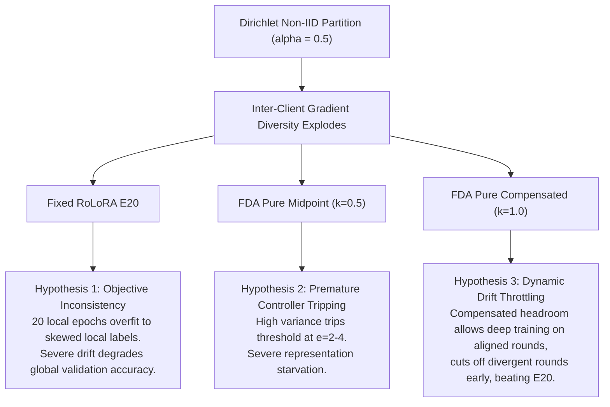

# Non-IID Experimental Plan: Robustness Stress-Test & Convexity Compensation

**Date:** October 2026  
**Status:** Ready for Execution  
**Target:** Stress-test **FDA-RoLoRA Pure** against competitive fixed baselines (**RoLoRA $E=10$** and **$E=20$**) under realistic non-IID label skew (Dirichlet $\alpha = 0.5$) on the two flagship GLUE NLI benchmarks (**QNLI** and **MNLI**).

---

## 1. Executive Summary & Scientific Motivation

### A. The Core Research Question
In our comprehensive 335-run benchmark suite ([`FDA_vs_Baselines_v2.md`](file:///C:/Users/PC/Documents/GitHub/FDA-LoRA/FDA_vs_Baselines_v2.md)), all evaluations were conducted in the high-IID regime ($\alpha = 1000$). Under IID data:
- On $C=50$, FDA decisively outperformed RoLoRA (e.g., $+8.44\%$ on MNLI, $+4.04\%$ on QNLI).
- On $C=20$, fixed baselines performed competitively because homogeneous clients rarely diverge, allowing fixed $E=20$ to pump local epochs without suffering catastrophic client drift.

**The Question:** What happens when real client heterogeneity is introduced? In the literature (*Theologitis et al., 2025*), FDA was designed specifically to prevent **client drift** in non-IID federations. This experiment tests whether fixed $E=20$ breaks down under non-IID drift and whether **Pure FDA with Convexity Compensation ($\kappa=1.0$)** dynamically stabilizes training.

### B. Pruning Decisions (Why This Matrix Is Lean & High-Signal)
1. **Focus on $C=20$:** Targets the specific regime where fixed baselines were strongest under IID.
2. **Drop RTE and MRPC:** Small datasets (under 3,700 samples) create extreme local sample starvation ($\sim 120$ samples/client), resulting in noisy, ungeneralizable variance.
3. **Drop $E=5$ and $E=15$:**
   - $E=5$ was severely under-trained even in IID (trailing by $8\text{--}15\%$).
   - $E=15$ only existed as an exploratory probe on MNLI, had high seed variance ($\pm 2.87\%$), and was strictly dominated by $E=10$.
4. **Anchor on Flagship Tasks (QNLI & MNLI):**
   - **QNLI (Binary NLI):** 2 classes, clean convergence, rapid execution.
   - **MNLI (3-Class Multi-Genre NLI):** 3 classes, creating complex orthogonal gradient conflicts across clients under Dirichlet $\alpha = 0.5$.

---

## 2. Experimental Matrix ($C=20, R=50, \alpha=0.5$, Seed 42)

* **Model Backbone:** `roberta-base` (125M parameters)
* **PEFT Budget:** $P2$ (Layers 7–11, Rank $r=4$, LoRA $\alpha=8$, Target modules: `query`, `value`)
* **Optimization:** Client SGD ($\eta = 0.10$, Batch Size = 32), Server SGD ($\eta_{\text{server}} = 1.0$)
* **Data Partitioning:** Dirichlet $\alpha = 0.5$ across $C=20$ clients (Full participation per round)

| Dataset | # | Method / Setting | Configuration | Expected Duty | Scientific Purpose / Comparison |
| :--- | :---: | :--- | :--- | :--- | :--- |
| **QNLI** ($C=20, R=50$) | **1** | **RoLoRA E10** | Fixed $E=10$ | $E=10$ | **Tier 1 Baseline**: Standard literature benchmark. |
| | **2** | **FDA Pure ($k=1.0, E_{\max}=20$)** | $E \in [1, 20]$, Compensated target | $\bar{e} \approx 11.4$ | **Tier 1 Parity**: Direct convexity-matched comparison with RoLoRA $E=10$. |
| | **3** | **RoLoRA E20** | Fixed $E=20$ | $E=20$ | **Tier 2 Baseline**: Deep compute ceiling; tests objective inconsistency. |
| | **4** | **FDA Pure ($k=1.0, E_{\max}=40$)** | $E \in [1, 40]$, Compensated target | $\bar{e} \approx 22.8$ | **Tier 2 Parity**: Direct convexity-matched comparison with RoLoRA $E=20$. |
| | **5** | **FDA Pure ($k=0.5, E_{\max}=20$)** | $E \in [1, 20]$, Midpoint target | $\bar{e} \approx 5.7$ | **Negative Control**: Tests if uncompensated midpoint collapses under non-IID variance. |
| **MNLI** ($C=20, R=50$) | **6** | **RoLoRA E10** | Fixed $E=10$ | $E=10$ | **Tier 1 Baseline**: Standard literature benchmark on 3-class label skew. |
| | **7** | **FDA Pure ($k=1.0, E_{\max}=20$)** | $E \in [1, 20]$, Compensated target | $\bar{e} \approx 11.4$ | **Tier 1 Parity**: Direct convexity-matched comparison with RoLoRA $E=10$ on MNLI. |
| | **8** | **RoLoRA E20** | Fixed $E=20$ | $E=20$ | **Tier 2 Baseline**: Deep compute baseline; check for client drift divergence. |
| | **9** | **FDA Pure ($k=1.0, E_{\max}=40$)** | $E \in [1, 40]$, Compensated target | $\bar{e} \approx 22.8$ | **Tier 2 Parity**: Direct convexity-matched comparison with RoLoRA $E=20$ on MNLI. |
| | **10** | **FDA Pure ($k=0.5, E_{\max}=20$)** | $E \in [1, 20]$, Midpoint target | $\bar{e} \approx 5.7$ | **Negative Control**: Evaluates representation starvation on 3-class label skew. |

---

## 3. Core Hypotheses to Validate

1. **Hypothesis 1 (Client Drift Degradation of $E=20$):**
   In IID, $E=20$ performed stably ($75.69\%$ on MNLI, $92.55\%$ on SST-2) because clients had matching distributions. In non-IID ($\alpha=0.5$), 20 continuous local epochs will cause local models to overfit to skewed label subsets, pulling the global model away from consensus (objective inconsistency).
2. **Hypothesis 2 (Premature Halting of Midpoint $\kappa=0.5$):**
   Because drift variance grows quadratically ($\text{Var} \propto e^2$), elevated baseline heterogeneity will cause the uncompensated midpoint controller to trip prematurely ($e \approx 2\text{--}4$), resulting in representation starvation.
3. **Hypothesis 3 (Convexity Compensation Superiority $\kappa=1.0$):**
   The $2\times$ threshold headroom under $\kappa=1.0$ provides the necessary dynamic buffer to absorb higher non-IID baseline variance while still terminating rounds that diverge abnormally.
4. **Hypothesis 4 (Convexity Factor Shift under Non-IID):**
   In IID, the realized duty ratio was invariant at $\gamma = \bar{e} / T_{\text{nominal}} \approx 0.57$. This experiment will measure how $\gamma$ shifts under strong non-IID data (e.g., whether it tightens to $\sim 0.45\text{--}0.50$).

---

## 4. Execution Schedule & Continuous 6-Lane Resource Budget

The execution utilizes the Polytechnix multi-GPU scheduler with **6 continuous concurrent worker slots** across 2 GPUs (3 jobs per 24GB A10 GPU):

### Continuous Multi-Stage Scheduler (Zero Inter-Stage Idle Time)
- **Initial Dispatch ($t=0$):**
  - Slots 1–4 immediately launch all **4 QNLI runs** (#1–4).
  - Slots 5–6 immediately launch the first **2 MNLI runs** (#5–6).
  - **All 6 GPU slots are 100% saturated immediately from the very first second.**
- **Dynamic Continuous Backfill:**
  - As soon as *any* lane completes (e.g., QNLI RoLoRA E10 finishes at $\sim 6.7$h), it immediately pulls the next pending MNLI run (#7 or #8) without waiting for other QNLI runs to finish.
  - This eliminates idle GPU starvation between stages and ensures 6 parallel jobs run at all times.
- **Estimated Total Wall-Clock Time:**
  - With continuous backfill across 6 slots, total suite duration drops from 34 hours to **$\approx 22\text{--}25$ hours total wall-clock time** (all 8 runs complete in ~1 day).

---

## 5. Early Stopping Protocol for Non-IID

To prevent premature termination during initial client reconciliation while safely pruning converged tails, the suite implements a specialized Non-IID early stopping policy:

| Parameter | Value | Rationale |
| :--- | :--- | :--- |
| `early_stopping_min_rounds` | **30** ($60\%$ of $R=50$) | Guarantees at least 30 rounds of uninterrupted drift and accuracy telemetry; never trips early. |
| `early_stopping_window` | **5** rounds | 5-round rolling moving average to filter out Dirichlet client sampling variance. |
| `early_stopping_patience` | **3** evaluations | Requires 3 consecutive flat smoothed evaluations without meaningful gain. |
| `early_stopping_min_delta` | **0.005** ($0.5\%$) | Minimum accuracy gain required to reset patience. |
| `plateau_min_accuracy` | **0.80** (QNLI) / **0.60** (MNLI) | Baseline performance gate before early stopping can activate. |

---

## 6. Implementation & Deployment Suite

1. **Self-Contained Suite (`non_iid_experiments/`):**
   - [`fda_rolora_non_iid.py`](file:///C:/Users/PC/Documents/GitHub/FDA-LoRA/non_iid_experiments/fda_rolora_non_iid.py): Standalone engine implementing both `FDA-RoLoRA-DualTrack-Pure` and `FedAvg-RoLoRA`, with per-round incremental CSV saving and 60% early stopping.
   - [`thesis_non_iid_experiments.py`](file:///C:/Users/PC/Documents/GitHub/FDA-LoRA/non_iid_experiments/thesis_non_iid_experiments.py): Master orchestrator (`plan`, `start`, `status`, `stop`, `drop`) with continuous 6-lane parallel scheduler.
   - [`run_non_iid_experiments.sh`](file:///C:/Users/PC/Documents/GitHub/FDA-LoRA/non_iid_experiments/run_non_iid_experiments.sh): Cluster bash launcher for Polytechnix.
   - [`run_non_iid_experiments.sh`](file:///C:/Users/PC/Documents/GitHub/FDA-LoRA/run_non_iid_experiments.sh) (Root): Convenience launcher dispatching directly to the suite.
   - [`README.md`](file:///C:/Users/PC/Documents/GitHub/FDA-LoRA/non_iid_experiments/README.md): Step-by-step drag-and-drop deployment instructions.
2. **Metrics & Logging:**
   - Store all metrics in `results/round_metrics/` with prefix `THESIS-NONIID-A0.5-...`.
   - Incrementally saved every single round so no telemetry is lost if stopped early.
   - Worker stdout/stderr logs written to `results/logs/thesis_non_iid/`.
   - Run control registry maintained in `results/run_control_non_iid/`.
3. **Thesis Integration:**
   - Add a dedicated chapter/section: **"Section 5: Empirical Robustness to Data Heterogeneity (Non-IID Dirichlet $\alpha=0.5$)"**.
   - Create a 4-curve telemetry comparison per task:
     1. Convergence trajectory (Acc vs Round).
     2. Allocated epochs per round (Duty cycle).
     3. Inter-client drift variance (Log scale).
     4. Accuracy vs Communication cost (MB).
