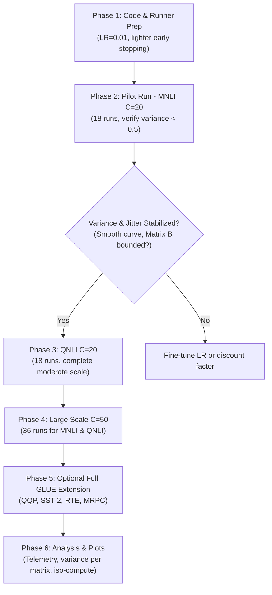

# Experimental Plan & Course of Action: RoLoRA vs. FDA-RoLoRA ($\eta = 0.01$)

**Date:** September 2026  
**Status:** Ready for Execution  
**Target:** Validate FDA-RoLoRA vs. RoLoRA on GLUE (`MNLI`, `QNLI`, and optional full GLUE extension) using the literature-consensus learning rate $\eta = 0.01$, a lighter early stopping configuration, and the supervisor-guided controller formulation ($\kappa = 0.5$, $E_{\max}/2$).

---

## 1. Executive Summary & Rationale

* **The Core Empirical Suspicion (Jittery Accuracy Trajectories):** In our existing runs at $\eta_{\text{client}} = 0.1$, the evaluation accuracy curves across communication rounds for **both RoLoRA and FDA-RoLoRA exhibit excessive jitter, oscillation, and instability**. Rather than following a smooth, monotonic convergence path, the models jump erratically round-to-round. This jitter occurs **even in our IID setting ($\alpha = 1000$)**, demonstrating that it is a direct consequence of an overly aggressive local step size: with $\eta = 0.1$ across multiple local epochs, stochastic local updates overshoot and clash upon server averaging. In alternating optimization, this is further exacerbated as unconstrained Matrix B updates drift rapidly while Matrix A attempts to project onto a stable subspace.
* **The Variance & Literature Evidence:** At $\eta_{\text{client}} = 0.1$, client drift variance was severely inflated ($\bar{\sigma}^2 \approx 4.88$, peaking at $13.98$), driven predominantly by Matrix B ($5.25\times$ higher median variance than Matrix A). Literature reveals that $\eta = 0.1$ is the extreme upper bound of RoLoRA's search grid, while all peer Fed-LoRA literature (FFA-LoRA, FedSA-LoRA, LoRA+) converges on **$\eta = 0.01$** for MNLI/QNLI.
* **The Solution:** Rerun experiments with **$\eta = 0.01$**. Because variance scales quadratically ($\sigma^2 \propto \eta^2$), lowering $\eta$ by $10\times$ will mathematically cut drift by $\approx 100\times$, eliminating the round-to-round accuracy oscillations, smoothing the learning dynamics, and allowing FDA's dynamic epoch controller to operate safely without triggering optimization instability.
* **Budget Scope:** Retain **Budget $P2$ only** (adapters on layers $7\text{--}11$). All 336 historical runs in this repository and the RoLoRA paper's main federated tables exclusively evaluate $P2$.
* **Controller Formulation:** Standard midpoint target $\kappa = 0.5$ ($E_{\max}/2$), pairing each fixed baseline $E = X$ with an FDA dynamic window $E \in [3, 2X]$.

---

## 2. Experimental Matrices

### A. Primary Target Matrix: MNLI & QNLI (72 Runs Total)

* **Datasets (2):** `MNLI`, `QNLI`
* **Model Backbone:** `roberta-base` ($r=4, \alpha=8$, Budget $P2$)
* **Client Settings (2):**
  * Moderate Scale: $C=20, R=50$
  * Higher Client Count: $C=50, R=30$
* **Seeds (3):** $S \in \{42, 43, 44\}$
* **Learning Rate:** $\eta_{\text{client}} = 0.01$, Server Opt: SGD ($\eta_{\text{server}} = 1.0$)

| Dataset | Client Setting | Baseline RoLoRA (Fixed) | Matched FDA-RoLoRA ($\kappa=0.5$) | Configs | Seeds | Total Runs |
| :--- | :---: | :---: | :---: | :---: | :---: | :---: |
| **MNLI** | **$C=20, R=50$** | $E=5, \; E=10, \; E=20$ | $E \in [3, 10], \; [3, 20], \; [3, 40]$ | 6 | $42, 43, 44$ | **18** |
| **MNLI** | **$C=50, R=30$** | $E=5, \; E=10, \; E=20$ | $E \in [3, 10], \; [3, 20], \; [3, 40]$ | 6 | $42, 43, 44$ | **18** |
| **QNLI** | **$C=20, R=50$** | $E=5, \; E=10, \; E=20$ | $E \in [3, 10], \; [3, 20], \; [3, 40]$ | 6 | $42, 43, 44$ | **18** |
| **QNLI** | **$C=50, R=30$** | $E=5, \; E=10, \; E=20$ | $E \in [3, 10], \; [3, 20], \; [3, 40]$ | 6 | $42, 43, 44$ | **18** |
| **Grand Total (MNLI + QNLI)** | | | | | | **72 runs** |

*(Compact Option: If FDA only runs standard $E \in [3, 20]$, total runs = **48**).*

---

### B. Full GLUE Benchmark Matrix Extension (180 or 216 Runs)

Every dataset requires **$36 \text{ runs}$** ($18$ at $C=20$ + $18$ at $C=50$ across 3 seeds):

| GLUE Suite | Tasks Included | Runs per Task | Full Symmetric Plan (3 FDA windows) | Compact Plan (FDA [3, 20] only) |
| :--- | :--- | :---: | :---: | :---: |
| **5-Task Suite** *(RoLoRA Standard)* | `MNLI`, `QNLI`, `QQP`, `SST-2`, `RTE` | 36 | **180 runs** | **120 runs** |
| **6-Task Suite** *(Full Repo Suite)* | Above + `MRPC` | 36 | **216 runs** | **144 runs** |
| **8-Task Suite** *(Full GLUE minus WNLI)* | Above + `CoLA`, `STS-B` | 36 | **288 runs** | **192 runs** |

---

## 3. Staged Course of Action

---

## 4. Detailed Execution Checklist

### Phase 1: Configuration & Script Preparation
- [ ] Create or update run configuration in `thesis_experiments.py` for $\eta = 0.01$:
  - Set `learning_rate: 0.01` for `mnli` and `qnli`.
  - Ensure controller ratio is set to $\kappa = 0.5$ (`CRATIO0.5`, default old controller).
  - Verify epoch pairings:
    - $E=5$ paired with FDA $E \in [3, 10]$
    - $E=10$ paired with FDA $E \in [3, 20]$
    - $E=20$ paired with FDA $E \in [3, 40]$
  - Adopt lighter early stopping parameters:
    - `patience: 5` (up from 3)
    - `min_delta: 0.002` (0.2%, down from 0.005 / 0.5%)
    - `min_rounds: 10` (up from 6)
- [ ] Validate GPU parallel scheduler lanes (3 jobs/GPU for batch 32).

### Phase 2: Pilot Execution (MNLI $C=20, R=50$) — 18 Runs
- [ ] Run RoLoRA fixed baselines ($E=5, 10, 20$) across Seeds $42, 43, 44$ (9 runs).
- [ ] Run FDA-RoLoRA dynamic ($[3, 10], [3, 20], [3, 40]$) across Seeds $42, 43, 44$ (9 runs).
- [ ] **Verification Checkpoints:**
  - [ ] **Trajectory Smoothness:** Verify that test accuracy curves across rounds are smooth and monotonic, eliminating the severe round-to-round jitter observed at $\eta = 0.1$.
  - [ ] Overall mean variance $\bar{\sigma}_t^2 < 0.5$ (vs. old $1.66\text{--}4.88$).
  - [ ] Matrix B variance bounded without runaway spikes ($<2.0$).
  - [ ] Accuracy comparison: Does FDA achieve competitive/superior accuracy with fewer cumulative epochs?

### Phase 3: Moderate Scale Completion (QNLI $C=20, R=50$) — 18 Runs
- [ ] Run RoLoRA fixed baselines ($E=5, 10, 20$) across Seeds $42, 43, 44$ (9 runs).
- [ ] Run FDA-RoLoRA dynamic ($[3, 10], [3, 20], [3, 40]$) across Seeds $42, 43, 44$ (9 runs).
- [ ] Confirm cross-task consistency between MNLI and QNLI.

### Phase 4: Large-Scale Execution ($C=50, R=30$) — 36 Runs
- [ ] Run MNLI $C=50, R=30$ (18 runs).
- [ ] Run QNLI $C=50, R=30$ (18 runs).
- [ ] Evaluate client drift and convergence with 50 clients in IID setting ($\alpha = 1000$).

### Phase 5: Optional Extension to Full GLUE Benchmark
- [ ] Run QQP, SST-2, RTE, MRPC ($108\text{--}144$ runs).

### Phase 6: Synthesis, Plotting & Final Supervisor Deliverables
- [ ] Generate aggregated multi-seed plots:
  - [ ] Test Accuracy vs. Communication Rounds (mean $\pm$ std).
  - [ ] Test Accuracy vs. Cumulative Client Epochs (Iso-Compute view).
  - [ ] Client Drift Variance per Round & per Epoch.
  - [ ] Disentangled Matrix A vs. Matrix B Variance across epochs.
  - [ ] Epoch Distribution Bins per Round.
- [ ] Produce comparative summary tables for thesis chapter / paper.

---

## 5. Hardware Parallelism, Early Stopping & Runtime Calculations

### A. Batch Size & Concurrency Dynamics
* **Batch Size Configuration:** Both `MNLI` and `QNLI` use **`batch_size = 32`** ([`MAIN_DATASET_SETTINGS`](file:///C:/Users/PC/Documents/GitHub/FDA-LoRA/thesis_experiments.py#L145)).
* **GPU Lane Scheduler:** In [`thesis_experiments.py`](file:///C:/Users/PC/Documents/GitHub/FDA-LoRA/thesis_experiments.py#L130), the default scheduler allocates:
  * `MAIN_JOBS_PER_GPU = 3` (up to 3 concurrent runs per GPU for batch 32).
  * `MAIN_BATCH64_JOBS_PER_GPU = 2` (safety cap of 2 runs for batch 64, e.g. SST-2).
* **Active Parallel Lanes:**
  * **On 2 GPUs (`cuda:0`, `cuda:1`):** Allows **$3 \text{ jobs} \times 2 \text{ GPUs} = \mathbf{6 \text{ concurrent runs}}$** simultaneously.
  * **On 4 GPUs:** Allows **$3 \text{ jobs} \times 4 \text{ GPUs} = \mathbf{12 \text{ concurrent runs}}$** simultaneously.

### B. Proposed Lighter Early Stopping Parameters
Historical logs show runs were previously cut off on the exact round they set their peak accuracy due to `patience = 3` and `min_delta = 0.005` ($0.5\%$). At $\eta = 0.01$, step sizes are $10\times$ smaller and progress is steady ($+0.15\%\text{--}+0.30\%$ per round), requiring a lighter configuration:

| Parameter | Old Setting | **Proposed Lighter Setting** | Rationale |
| :--- | :---: | :---: | :--- |
| **Patience (`P`)** | `3` rounds | **`5` rounds** | Allows alternating $A/B$ cycles 2 full loops to show gains without premature kills. |
| **Min Delta (`D`)** | `0.005` ($0.5\%$) | **`0.002` ($0.2\%$)** | Accommodates the refined step size of $\eta = 0.01$ without falsely declaring plateau. |
| **Min Rounds (`MR`)** | `6` rounds | **`10` rounds** | Ensures at least 10 rounds of training before patience clock can arm. |
| **Window Size (`W`)** | `3` rounds | **`3` rounds** | Retains 3-round rolling mean to smooth residual stochastic noise. |
| **Start Accuracy Gate** | MNLI: $60\%$, QNLI: $80\%$ | **Unchanged** | Prevents early stopping from arming during initial warmup. |

* **Empirical Time Reduction:** With early stopping active, plateaued runs gracefully exit around round $\approx 28\text{--}34$, saving $\approx 35\text{--}40\%$ compute compared to full 50 rounds. Average run duration is **$\approx 30\text{--}35$ minutes per run**.

### C. Wall-Clock Completion Schedule

| Execution Scope | Total Runs | Scheduling Waves (at 6 jobs concurrent on 2 GPUs) | Est. Wall-Clock Time (2 GPUs, 6 Lanes) | Est. Wall-Clock Time (4 GPUs, 12 Lanes) |
| :--- | :---: | :---: | :---: | :---: |
| **Phase 2: Pilot MNLI ($C=20, R=50$)** | **18** | $\frac{18}{6} = \mathbf{3 \text{ waves}}$ | **$\approx 1.5\text{--}1.75 \text{ hours}$** | $\approx 50 \text{ minutes}$ |
| **Phase 3: Add QNLI ($C=20, R=50$)** | **18** | $\frac{18}{6} = \mathbf{3 \text{ waves}}$ | **$\approx 1.5\text{--}1.75 \text{ hours}$** | $\approx 50 \text{ minutes}$ |
| **Subtotal (Moderate Scale $C=20$, Both Tasks)** | **36** | $\frac{36}{6} = \mathbf{6 \text{ waves}}$ | **$\approx 3.0\text{--}3.5 \text{ hours}$** | **$\approx 1.75 \text{ hours}$** |
| **Phase 4: Large Scale ($C=50$, Both Tasks)** | **36** | $\frac{36}{6} = \mathbf{6 \text{ waves}}$ | **$\approx 3.0\text{--}3.5 \text{ hours}$** | **$\approx 1.75 \text{ hours}$** |
| **Total Core Matrix (MNLI + QNLI)** | **72** | $\frac{72}{6} = \mathbf{12 \text{ waves}}$ | **$\approx 6.5\text{--}7.5 \text{ hours}$ (Overnight)** | **$\approx 3.5 \text{ hours}$** |
| **Full 5-Task GLUE Suite** | **180** | $\frac{180}{6} = \mathbf{30 \text{ waves}}$ | **$\approx 17\text{--}19 \text{ hours}$** | **$\approx 8.5\text{--}9.5 \text{ hours}$** |
| **Full 6-Task GLUE Suite (with MRPC)** | **216** | $\frac{216}{6} = \mathbf{36 \text{ waves}}$ | **$\approx 20\text{--}22 \text{ hours}$ ($\approx 1\text{ day}$)** | **$\approx 10\text{--}11 \text{ hours}$** |

---

## 6. Runner Scripts: Command Reference, Operator Controls & Rationale

Standalone execution scripts are located in [`lr001_experiments/`](file:///C:/Users/PC/Documents/GitHub/FDA-LoRA/lr001_experiments) (with synchronized mirrors at the repository root):
* **Bash Wrapper (GPU Server):** [`lr001_experiments/run_lr001_mnli_qnli.sh`](file:///C:/Users/PC/Documents/GitHub/FDA-LoRA/lr001_experiments/run_lr001_mnli_qnli.sh) (handles environment variables, auto-logging to `logs/`, and process control).
* **Python Engine:** [`lr001_experiments/run_lr001_mnli_qnli.py`](file:///C:/Users/PC/Documents/GitHub/FDA-LoRA/lr001_experiments/run_lr001_mnli_qnli.py) (implements cheapest-first sorting and dynamic 3-lane/GPU worker replenishment).

### Quick-Reference Command Table

| Action / Workflow | Server Bash Command | Python Command (`gpu_server_env`) | Primary Use Case & Rationale |
| :--- | :--- | :--- | :--- |
| **Pre-Flight Verification** | `./lr001_experiments/run_lr001_mnli_qnli.sh --dry-run` | `python lr001_experiments/run_lr001_mnli_qnli.py --dry-run` | Instant zero-cost verification of planned run tags, parameters, and cheapest-first order. |
| **Pilot Wave (18 runs)** | `./lr001_experiments/run_lr001_mnli_qnli.sh --dataset mnli --clients 20` | `python lr001_experiments/run_lr001_mnli_qnli.py --dataset mnli --clients 20` | Rapid test ($\approx 1.5$ hrs) to confirm jitter elimination and variance reduction before full scale. |
| **Full Production Suite (72 runs)** | `./lr001_experiments/run_lr001_mnli_qnli.sh` | `python lr001_experiments/run_lr001_mnli_qnli.py` | Complete overnight execution of MNLI & QNLI across $C=20$ and $C=50$ (all 3 seeds). |
| **Check Live Status & Metrics** | `./lr001_experiments/run_lr001_mnli_qnli.sh status` | `python lr001_experiments/run_lr001_mnli_qnli.py --status` | Non-intrusive live check from another terminal: prints active PIDs, GPUs, elapsed time, and latest accuracy. |
| **Gracefully Stop/Kill One Run** | `./lr001_experiments/run_lr001_mnli_qnli.sh stop <ID>` | `python lr001_experiments/run_lr001_mnli_qnli.py --stop <ID>` | Sends `SIGTERM` to a specific worker; scheduler automatically launches the next queued run into the freed lane. |
| **Task-Specific Execution** | `./lr001_experiments/run_lr001_mnli_qnli.sh --dataset qnli` | `python lr001_experiments/run_lr001_mnli_qnli.py --dataset qnli` | Run only QNLI (36 runs) if executing tasks in separate stages. |
| **Client-Scale Execution** | `./lr001_experiments/run_lr001_mnli_qnli.sh --clients 50` | `python lr001_experiments/run_lr001_mnli_qnli.py --clients 50` | Run only the $C=50, R=30$ matrix (36 runs). |
| **Custom GPU Allocation** | `./lr001_experiments/run_lr001_mnli_qnli.sh --gpus 0,1 --jobs-per-gpu 3` | `python lr001_experiments/run_lr001_mnli_qnli.py --gpus 0,1 --jobs-per-gpu 3` | Pin explicit GPU device IDs and control lane concurrency when sharing a multi-user server. |

---

### Detailed Rationale: Why and When to Run Each Command

#### 1. Dry Run (`--dry-run`)
* **Command:** `./lr001_experiments/run_lr001_mnli_qnli.sh --dry-run`
* **Why run this first:** Before allocating GPU memory or launching background processes, `--dry-run` renders the exact ordered queue of planned experiments without executing anything. It confirms:
  1. That dataset tags, learning rate (`-LR0.01-`), controller mode (`-fda-standard-`), and early stopping parameters (`-MR10-P5-D0.002-W3`) are formatted correctly without namespace conflicts.
  2. That the **cheapest runs are properly front-loaded** ($R=30$ runs scheduled before $R=50$).
  3. Which runs are already completed vs. pending (useful for resume safety).

#### 2. Pilot Wave (`--dataset mnli --clients 20`)
* **Command:** `./lr001_experiments/run_lr001_mnli_qnli.sh --dataset mnli --clients 20`
* **Why run this before the full suite:** The pilot wave executes only **18 runs** ($C=20$, $R=50$, across $E \in \{5, 10, 20\}$ and FDA tiers $[3, 10], [3, 20], [3, 40]$ for seeds 42, 43, 44), taking only **$\approx 1.5\text{--}1.75\text{ hours}$** on 2 GPUs.
* **Empirical Verification Objectives:**
  * **Jitter Elimination:** Verify that test accuracy curves across rounds transition from erratic sawtooth oscillations to smooth, monotonic trajectories.
  * **Drift Variance Reduction:** Verify that parameter drift variance drops by $\approx 100\times$ from historical peaks ($1.66\text{--}4.88 \rightarrow < 0.05$).
  * **Early Stopping Verification:** Confirm that the lighter early stopping criteria ($P=5, \Delta=0.2\%, MR=10$) allow healthy convergence without terminating prematurely.
  * **Decision Gate:** If the pilot demonstrates smooth curves and low variance, proceed with 100% confidence to the full suite.

#### 3. Full 72-Run Production Suite
* **Command:** `./lr001_experiments/run_lr001_mnli_qnli.sh`
* **Why run this:** Executes the complete primary benchmark (MNLI + QNLI across both $C=20$ and $C=50$ scales for all 3 seeds).
* **Execution Dynamics:**
  * **Cheapest Runs First:** Runs start with fast $R=30, E=5$ jobs and progressively step up to heavier tiers, providing continuous result milestones from hour 1.
  * **Continuous Dynamic Replenishment:** Operates an asynchronous 6-worker pool (on 2 GPUs). Whenever any worker finishes or hits early stopping, the scheduler immediately refills that GPU lane.
  * **Fault-Tolerant Logging:** Standard output and error streams are displayed live in the console while simultaneously saved to a timestamped file in `logs/run_lr001_<timestamp>.log`.

#### 4. Live Telemetry Inspection (`status`)
* **Command:** `./lr001_experiments/run_lr001_mnli_qnli.sh status`
* **Why run this:** While long-running experiments execute in the background (or in a `tmux` session), you can open a secondary shell at any time to inspect the cluster without disturbing training.
* **Information Displayed:**
  * Active run count.
  * For each active lane: `[control_id]`, operating system `PID`, assigned `GPU` (`cuda:0` / `cuda:1`), and elapsed wall-clock time (`HH:MM:SS`).
  * Full run configuration ID.
  * **Live evaluation metric:** The latest validation accuracy and loss parsed directly from the worker log (e.g. `round=18/50 eval_acc=0.7842 eval_loss=0.5120`).
  * Direct path to the worker's `.out` log file for in-depth tailing.

#### 5. Graceful Worker Termination (`stop <ID>`)
* **Command:** `./lr001_experiments/run_lr001_mnli_qnli.sh stop <CONTROL_ID or PID>`
* **Why run this:** If live telemetry reveals that an individual run is diverging, experiencing CUDA issues, or unneeded, you do not need to kill the master scheduler.
* **Mechanism:**
  * Cleanly dispatches a `SIGTERM` directly to that worker process group.
  * Removes the run record from `results/run_control/active/`.
  * Logs an operator event record in `results/run_control/operator_events.jsonl`.
  * **Instant refill:** The central dispatcher immediately detects the idle lane and **automatically pulls the next queued experiment** to keep GPU utilization at 100%.

