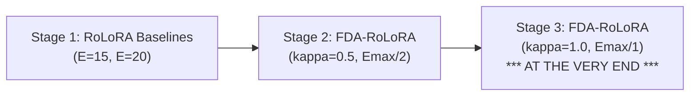

# RoLoRA vs. FDA-RoLoRA Threshold Controller Experiments ($\kappa=0.5$ vs. $\kappa=1.0$)

This module provides the standalone runner and cluster orchestration scripts for evaluating **RoLoRA fixed-epoch baselines ($E=15, 20$)** against **FDA-RoLoRA dynamic epoch controllers** using both the standard midpoint setpoint ($\kappa = 0.5$, $E_{\max}/2$) and the full upper threshold setpoint ($\kappa = 1.0$, $E_{\max}/1$).

---

## 1. Experimental Staging & Order of Execution

Experiments are strictly partitioned and queued into three consecutive stages:



1. **Stage 1 (RoLoRA Fixed Baselines):**
   * Fixed local epochs $E = 15$ and $E = 20$.
   * Serves as the ground-truth benchmark for high-epoch local training before evaluating adaptive epoch scaling.
2. **Stage 2 (FDA-RoLoRA Midpoint Setpoint $\kappa = 0.5$):**
   * Dynamic windows: $E \in [3, 30]$ (paired with $E=15$) and $E \in [3, 40]$ (paired with $E=20$).
   * Threshold setpoint: $\kappa = 0.5$ ($E_{\max}/2 = 15$ and $20$ respectively).
3. **Stage 3 (FDA-RoLoRA Upper Threshold $\kappa = 1.0$ — Executed at the Very End):**
   * Dynamic windows: $E \in [3, 30]$ and $E \in [3, 40]$.
   * Threshold setpoint: $\kappa = 1.0$ ($E_{\max}/1 = 30$ and $40$ respectively).
   * Runs strictly after Stages 1 and 2 have completed.

---

## 2. Configuration & Parameter Matrix (MNLI $C=20, R=50$)

* **Model Backbone:** `roberta-base` ($r=4, \alpha=8$, Budget $P2$: top layers 7–11)
* **Dataset:** MNLI ($C=20, R=50$, $\alpha=1000$ IID)
* **Learning Rates:** Client SGD $\eta = 0.01$, Server SGD $\eta_{\text{server}} = 1.0$
* **Strict Early Stopping Restored:**
  * Accuracy Gate: $\text{ES} = 0.60$ ($60.0\%$ accuracy on MNLI dev set)
  * Minimum Communication Rounds: $\text{MR} = 6$
  * Plateau Patience: $P = 3$ rounds
  * Required Minimum Delta: $D = 0.005$ ($0.5\%$ improvement)
  * Smoothing Window: $W = 3$ rounds

| Stage | Method | Epoch Config | Controller Setpoint | Seeds | Metric Tag Prefix |
| :--- | :--- | :---: | :---: | :---: | :--- |
| **Stage 1** | RoLoRA | $E = 15$ | Fixed | 42, 43, 44 | `THESIS-RBASE-MAIN-DS-mnli-C20-R50-M-rolora-LR0.01-RK4-S{seed}-E15-...` |
| **Stage 1** | RoLoRA | $E = 20$ | Fixed | 42, 43, 44 | `THESIS-RBASE-MAIN-DS-mnli-C20-R50-M-rolora-LR0.01-RK4-S{seed}-E20-...` |
| **Stage 2** | FDA-RoLoRA | $E \in [3, 30]$ | $\kappa = 0.5$ ($E_{\max}/2 = 15$) | 42, 43, 44 | `THESIS-RBASE-MAIN-DS-mnli-C20-R50-M-fda-k05-LR0.01-RK4-E3TO30-S{seed}-...` |
| **Stage 2** | FDA-RoLoRA | $E \in [3, 40]$ | $\kappa = 0.5$ ($E_{\max}/2 = 20$) | 42, 43, 44 | `THESIS-RBASE-MAIN-DS-mnli-C20-R50-M-fda-k05-LR0.01-RK4-E3TO40-S{seed}-...` |
| **Stage 3** | FDA-RoLoRA | $E \in [3, 30]$ | $\kappa = 1.0$ ($E_{\max}/1 = 30$) | 42, 43, 44 | `THESIS-RBASE-MAIN-DS-mnli-C20-R50-M-fda-k1-LR0.01-RK4-E3TO30-S{seed}-...` |
| **Stage 3** | FDA-RoLoRA | $E \in [3, 40]$ | $\kappa = 1.0$ ($E_{\max}/1 = 40$) | 42, 43, 44 | `THESIS-RBASE-MAIN-DS-mnli-C20-R50-M-fda-k1-LR0.01-RK4-E3TO40-S{seed}-...` |

> Total Runs: **18 runs** (3 seeds) or **12 runs** (2 seeds: 42, 43).

---

## 3. Usage & Command Cheatsheet

Both the Python runner (`run_threshold_experiments.py`) and Bash wrapper (`run_threshold_experiments.sh`) support identical CLI arguments.

### A. Preview / Dry Run
```bash
# Preview the complete 18-run queue and verification of stage ordering
./run_threshold_experiments.sh --dry-run

# Preview RoLoRA baseline runs only
./run_threshold_experiments.sh --stage rolora --dry-run

# Preview with 2 seeds (42, 43)
./run_threshold_experiments.sh --seeds 42,43 --dry-run
```

### B. Staged Execution Workflow

#### Step 1: Run RoLoRA Baselines First
```bash
./run_threshold_experiments.sh --stage rolora
```
*(On 2 GPUs with 3 lanes/GPU, all 6 runs execute in parallel and finish in ~19.1 hours).*

#### Step 2: Run FDA-RoLoRA ($\kappa = 0.5$)
```bash
./run_threshold_experiments.sh --stage fda_k05
```
*(Executes all 6 runs in parallel and finishes in ~15.5 hours).*

#### Step 3: Run FDA-RoLoRA ($\kappa = 1.0$) at the Very End
```bash
./run_threshold_experiments.sh --stage fda_k1
```

#### Single Command to Run All Stages Sequentially (Stage 1 -> Stage 2 -> Stage 3)
```bash
./run_threshold_experiments.sh start
```
*(Executes Stage 1 across all 6 lanes, waits until completion, then executes Stage 2, waits until completion, and finally executes Stage 3).*

---

## 4. Hardware & Cluster Controls

```bash
# Explicit GPU device allocation
./run_threshold_experiments.sh --gpus 0,1 --jobs-per-gpu 3

# Check active workers, PID, and live metrics
./run_threshold_experiments.sh status

# Gracefully stop a running worker without terminating the scheduler
./run_threshold_experiments.sh stop <CONTROL_ID or RUN_ID>
```

---

## 5. Portability & Drag-and-Drop (ARIS)

This directory is completely self-contained and portable:
* You can drag and drop this entire folder (`threshold_controller_experiments/`) into your ARIS directory.
* The scripts dynamically detect the repository root and resolve `thesis_experiments.py`, `fdaopt/`, and `results/round_metrics/` automatically.
